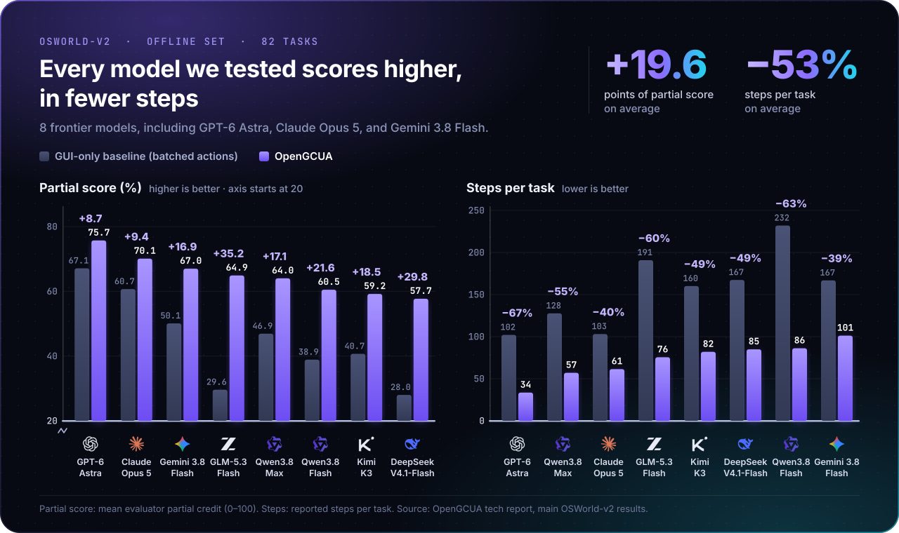
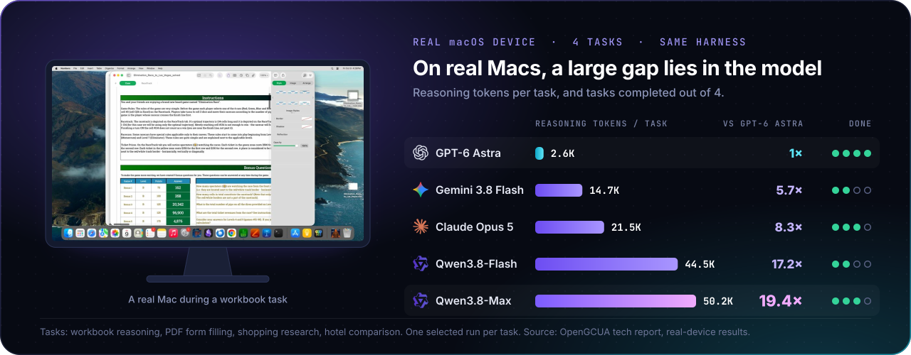
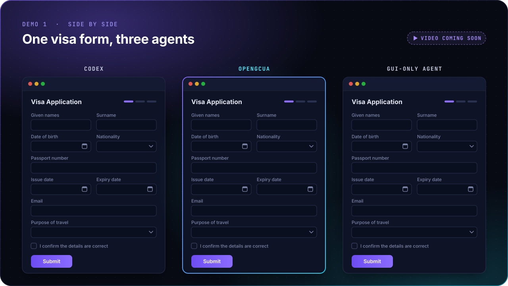
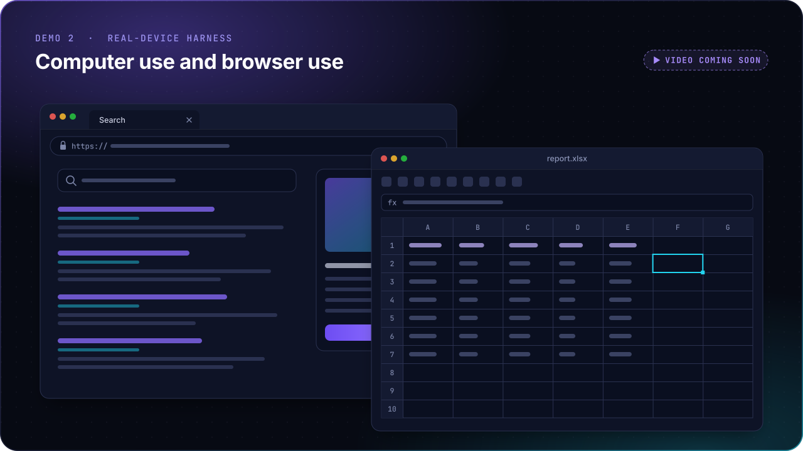

<a name="top"></a>

<div align="center">


### GPT-6 made computer use the frontier. We make it open.

[](https://tongyi-mai.github.io/OpenGCUA/)
[](https://arxiv.org/abs/2610.22200)
[](#quick-start)
[](LICENSE)
[](#community)
[](#community)

[News](#news) · [Results](#results) · [Demos](#demos) · **[Quick start](#quick-start)** · [SDK](#sdk) · [Open stack](#open-stack) · [How it works](#how-it-works) · [Contributing](#contributing) · [Contact](#contact)

</div>

<br>

**Computer use has reached a turning point.** GPT-6 Astra's demos offered an exciting vision of what
computer-use agents could make possible, and the focus is expanding from GUI-only interaction to both visual
and programmatic interfaces. The question has changed, from how well a model operates a GUI to how well a
system completes work on a real computer by whatever means works.

**We call such a system a generalist computer-use agent (GCUA).** It uses a computer in more ways than you do.
It reads the accessibility tree and calls app APIs, runs shell commands, and operates the GUI when it needs to.
With **code execution**, it writes GUI operations as code and combines them with all of these in one program,
with loops and conditions. It can also share the computer with you, working in background windows without
interrupting what you are doing.

**Yet frontier systems remain largely closed.** We therefore introduce **Open Generalist CUA (OpenGCUA)**, an
ongoing project to develop and open the full stack for GCUAs with the community, including model, system,
trajectories, efficiency optimization, and evaluation.

**What we open in this version:**

- 🧠 **[OSWorld integration example](packages/harness/examples/osworld/)** with reference screenshot-action
  and code-action agents for integrating the OpenGCUA design.
- 📜 **Evaluation trajectories** of the 8 frontier models, including GPT-6 Astra, Claude Opus 5,
  and Gemini 3.8 Flash.
- 💻 **[macOS real-device harness](packages/harness/)** (preliminary), a menu-bar app that runs the agent on your own Mac.
- 🔌 **[Cross-Device SDK](packages/sdk/)** (preliminary), one programming interface for computers, browsers, and phones.

🗺️ See the [detailed plan for our open stack](#open-stack).

<a name="news"></a>

## 🔥 News

<!-- Add new entries at the top, newest first. Keep version numbers in GitHub Releases, not here. -->
- **[2026-10]** 🚀 The OpenGCUA research preview is out, with the [tech report](https://arxiv.org/abs/2610.22200), the
  [OSWorld integration example](packages/harness/examples/osworld/), the [macOS real-device harness](packages/harness/), the
  [Cross-Device SDK](packages/sdk/), and evaluation trajectories of 8 frontier models.

<a name="results"></a>

## 📊 Results

We test the design on two fronts: OSWorld-v2 with eight frontier models, and real Macs with our real-device
harness.



- **Every model improves, including GPT-6 Astra, Claude Opus 5, and Gemini 3.8 Flash.** Over a GUI-only
  baseline with batched actions, the mean partial score rises from 45.3 to 64.9 (+19.6 points), and steps per
  task fall by 53% on average. GPT-6 Astra goes from 102 to 34 steps per task.
- **Weaker models gain the most.** GLM-5.3-Flash gains 35.2 points and DeepSeek-V4.1-Flash 29.8. The gap
  between the strongest and the weakest model shrinks from 39.1 to 18.0 points.
- **Code execution adds value beyond shell access.** With the same GUI and shell access, writing operations as
  code adds 6.1 points and cuts steps by 14.8% over a GUI+CLI agent (mean of three models).



With our real-device harness held fixed, on four macOS tasks Qwen3.8-Max used 19.4 times the reasoning tokens
of GPT-6 Astra and still completed fewer tasks. The case studies trace this gap to model behavior, which is what
our next release, the GCUA model, works on. The [paper](https://arxiv.org/abs/2610.22200) has the full setup, ablations, and case
studies.

<a name="demos"></a>

## 🎬 Demos

<!-- DEMO VIDEOS: replace each placeholder  below with its video. Drag the video file into any issue or
     pull-request comment box on GitHub (no need to post the comment), copy the
     https://github.com/user-attachments/assets/... URL it produces, and paste that URL on its own line in place
     of the  line. GitHub renders it as a video player. Videos can be up to 10 MB on a free GitHub plan and
     100 MB on a paid plan, and .mp4 with H.264 plays in the most browsers. In each caption, state the playback
     speed (for example, 4×) and the model behind each agent. -->

**One visa form, three agents.** Codex, OpenGCUA, and a GUI-only agent fill in the same visa application on a
real Mac.

<!-- Demo 1: put the three runs side by side in one video, started together, with a clock in each pane. When the
     runs are final, add each agent's time and number of steps to the caption above. -->


**Computer use and browser use.** OpenGCUA completes tasks in desktop apps and in the browser on a real Mac.



**One task across a phone and a computer.** With the Cross-Device SDK, OpenGCUA works on a phone and a Mac to
complete one task.



<a name="quick-start"></a>
## 🚀 Quick Start (macOS source harness)

This is the shortest path from a clean clone to an interactive agent. It requires macOS 14+,
[uv](https://docs.astral.sh/uv/), Python 3.11–3.14, Rust/Cargo 1.89+, and Xcode Command Line Tools.
Python 3.12 is recommended. Prebuilt SDK wheels do not require Rust.

> **Safety warning:** the harness executes Python and Bash written by the model on your Mac.
> This is not a security sandbox. Use a test account or machine whose files and application
> state you can afford to change, and do not expose the local demo server to untrusted networks.

```bash
git clone <this-repo> OpenGCUA
cd OpenGCUA

uv venv --python 3.12
source .venv/bin/activate
uv pip install -e ./packages/sdk -e ./packages/harness/runtime

# Install the native driver app. Its daemon is included in the app bundle.
.venv/bin/mu setup macos

# Create a private local configuration from the shipped defaults.
cp packages/harness/configs/macos_demo.json packages/harness/configs/local.json
```

Edit the following fields in `packages/harness/configs/local.json`:

```json
{
  "api_key": "YOUR_API_KEY",
  "model_name": "qwen3.8-flash",
  "llm_base_url": "https://dashscope.aliyuncs.com/compatible-mode/v1",
  "llm_protocol": "openai"
}
```

Keep the other fields copied from `macos_demo.json`; the object above shows only the values
normally changed. Chat Completions-compatible gateways use `"llm_protocol": "openai"`;
GPT reasoning endpoints with Responses support can use `"openai-thinking"` to replay
encrypted reasoning across turns. Native Anthropic Messages endpoints use `"anthropic"`;
set `"anthropic_thinking": {"type": "adaptive"}` in `local.json` for Claude models
that support adaptive thinking. The Anthropic path preserves signed thinking blocks
in subsequent requests; `reasoning_effort` is not an Anthropic thinking switch.
Provider examples and every advanced setting are documented
in [Setup, configuration, and troubleshooting](QUICKSTART.md).

Grant **CuaDriver.app** access in **System Settings → Privacy & Security → Accessibility** and
**Screen Recording**, quit and reopen CuaDriver, then verify the installation:

```bash
.venv/bin/mu doctor macos
```

Start either the terminal agent or the browser demo studio. The terminal command automatically
uses the visual interface when stdin/stdout are an interactive terminal; pipes and `TERM=dumb`
keep the compatible plain-text interface.

```bash
# Persistent visual terminal conversation. Type /exit or press Ctrl-D to stop.
.venv/bin/python packages/harness/runtime/mac_agent.py

# Force the original line-oriented output (also useful for scripts and logs).
.venv/bin/python packages/harness/runtime/mac_agent.py --ui plain

# Or start the demo studio at http://127.0.0.1:8800.
bash packages/harness/runtime/start_demo.sh
```

In the visual terminal, reasoning and generated code are hidden by default. Use `/reasoning on`
or `/code on` to show future output, `/help` for shortcuts, and Alt/Option+Enter to insert a
newline. Ctrl-C during an active step aborts that turn; operations already sent to applications
or the shell are not rolled back.

If you see `PERMISSION_DENIED`, `DEVICE_OFFLINE`, a native-extension import error, or a recording
problem, use the [error-indexed troubleshooting guide](QUICKSTART.md#troubleshooting). For SDK-only
installation and wheel builds, see the [SDK guide](packages/sdk/README.md#install). The standalone
[native macOS app](packages/macos/README.md) is a separate distribution path with its runtime bundled.

### Run modes

The `our harness` (`mac_agent`) path supports three execution modes:

| Mode | Browser | Native apps such as Excel and Word | Intended use |
|---|---|---|---|
| **Balanced** (default) | Visible, dedicated browser | Background AX/window-scoped operations first; foreground input only as a fallback | Normal interactive work |
| **Background** | Headless, dedicated browser | Avoid activation, frontmost windows, desktop clicks, and real keyboard/mouse input; prefer file APIs, AX, and window-scoped observation | Work alongside the user with minimal disruption |
| **Demo** | Visible browser | Activate target windows and prefer visible, real keyboard/mouse actions with short pacing delays | Recording and live demonstrations |

Background mode is a best-effort low-interference policy, not a separate desktop, VM, or hard
OS sandbox. Apps may still show a window or take focus when launched, and some controls—especially
Office ribbons, dialogs, web views, and multi-window keyboard flows—may require foreground input.
When a task cannot be completed safely in the background, the agent should ask before temporarily
switching to a foreground action. For document-heavy tasks it prefers direct file libraries such as
`openpyxl` and `python-docx` when they can produce the requested result without driving the UI.

Enable Background mode from the demo hub toolbar before starting a new session, with the CLI flag
`--background-mode`, or with `"background_mode": true` in the gitignored
`packages/harness/configs/local.json`. Background and Demo modes are mutually exclusive and are read when a
new agent process starts, so changing either switch does not affect an already-running session.
These modes apply to `mac_agent` only: the `gui-only (pyautogui)` baseline always drives the real
foreground desktop and cannot run invisibly in the background.

## Native macOS app

[OpenGCUA for macOS](packages/macos/README.md) implements the menu bar assistant:
enter a task, collapse into a floating control panel, reply to questions, and
review saved results. SwiftUI + AppKit, with Python, the SDK and signed CuaDriver
bundled inside the app; no browser or separately installed runtime is required.
Apple Silicon / macOS 14+, currently a local development build. See the app guide
for building, packaging and the remaining public-release validation.
Version tags can automatically build the DMG and Python SDK downloads through
GitHub Actions.

<a name="sdk"></a>

## 🔌 Cross-Device SDK

The Cross-Device SDK is the interface the model programs against. It binds every operation to an explicit
device, app, window, or tab, keeps accessibility and vision as separate ways to observe and act, and lets one
program coordinate several devices in a task.

```python
import asyncio
from qwen_intelligence import Runtime

async def main():
    async with Runtime() as runtime:
        await runtime.add_macos(name="local-mac")
        async with runtime.session() as mu:
            mac = await mu.register("local-mac", name="mac")
            app = await mac.apps.get("com.apple.TextEdit")
            await mu.emit(await app.ui.ax.observe())   # TextEdit's accessibility tree
            await mu.emit(await app.windows.list())

asyncio.run(main())   # open TextEdit first
```

It has adapters for macOS, Android, browsers, and Linux, built on a Rust core with Python bindings.
The [source setup above](#quick-start) installs it. The package is `qwen-intelligence-sdk`, imported as `qwen_intelligence`
(`mai_ui` is the same API under its internal name). See [`packages/sdk/`](packages/sdk/) and the [examples](packages/sdk/examples/src/).

<a name="open-stack"></a>

## 🗺️ The open stack and what comes next

OpenGCUA aims to open the full stack of generalist computer use. This preview releases the first layers, and
the rest come next.

![The full open stack. Model: a GCUA model for both computer use and browser use, next. Agent design: the OpenGCUA harness for OSWorld-v2 with code execution and harness-to-model decision transfer, released. Real device: the macOS real-device harness, a menu-bar app, and the Cross-Device SDK, both preliminary. Trajectory: execution trajectories of 8 frontier models including GPT-6 Astra, Claude Opus 5 and Gemini 3.8 Flash, released. Efficiency: execution efficiency through code execution, thinking length, harness design, and system-level improvements, next. Evaluation: real-device environments and a benchmark, next.](site/assets/readme/stack.svg)

- [x] [OSWorld integration example](packages/harness/examples/osworld/) with standalone screenshot-action and code-action agents
- [x] macOS real-device harness and Cross-Device SDK, as preliminary open-source versions
- [x] [Native OpenGCUA macOS app](packages/macos/README.md), a preview menu-bar assistant with a floating task panel, voice, and bundled harness, SDK, and driver
- [ ] **GCUA model** for both computer use and browser use, turning code execution, on-demand observation, and
      task tracking into learned skills
- [ ] **Execution efficiency**, an essential problem for computer use: optimizing code execution, thinking
      length, and harness design, and exploring broader system-level improvements
- [ ] **Real-device environments and benchmark**, macOS first, measuring useful work under real conditions
- [ ] **Reliable work on your devices**: tasks across computers, browsers, and phones, with dependable
      targeting, recovery from failures, and continuity when you step in

We do not commit to dates. The plan follows the evidence and what the community proposes, including
directions beyond this list. Details are in [ROADMAP.md](ROADMAP.md).

<a name="how-it-works"></a>

## 🧩 How it works

Formally, a GCUA is an agent system that completes diverse computer tasks through visual interaction and
programmatic access, choosing **how to observe, act, and organize its work** as each task requires. These are
three decisions made at every step. A GUI agent leaves all three to fixed rules in its harness. OpenGCUA lets
the model make them.

| Decision | GUI agent | OpenGCUA |
|:--|:--|:--|
| 👁️ **What to observe** | a screenshot after every action | `screenshot()`, only when the model needs one |
| ✋ **How to act** | one click or keystroke at a time | a Python program that combines the accessibility tree and app APIs, shell commands, and GUI actions, with loops, branches, and checks |
| 🗂️ **How to organize work** | fixed by the harness | the model keeps a `todo` list and states its `<intent>` before each program |

Two designs make this work. **Code execution** lets a model bring the programming skill it already has, and
lets intermediate results decide the next operation without another model call. **Harness-to-model decision
transfer** moves choices such as when to look and what to track out of harness rules and into the model.
GUI agents, CLI agents, and GUI+CLI hybrids such as our earlier Qwen-UI-Agent are special cases that fix some
of these decisions in advance.

Here is one real step by GPT-6 Astra on a CRM task in OSWorld-v2. Lines marked `...` are cut, and long lines
are wrapped:

```python
<intent>Apply the 29 evidence-based status changes while preserving all original
customer details.</intent>
<code>
todo.update(id="updates", kind="task", content="Applying 29 reviewed status changes ...",
            status="attempted")
r = bash(r"""...
cat > /tmp/apply_lead_statuses.py <<'PY'
...
current=api(p,'/api/crm/workspace')['workspace']
assert current==original,'Workspace changed since original review; stopped before edits.'
for change in changes:
    d=api(p,'/api/crm/leads/'+change['leadId'],'PATCH',{'status':change['to']})
    ...
    assert lead['status']==change['to']
...
print('VERIFIED:',len(log),'status changes; all 40 statuses correct; ...')
PY
python /tmp/apply_lead_statuses.py""")
if r.ok:
    todo.update(id="status_updates", kind="task",
                content="Applied and API-verified all 29 planned status changes. ...",
                status="claimed_verified")
</code>
```

In one step, the model states its intent and records its plan. It then writes and runs a script that stops if
the app changed since it last looked, applies 29 edits through the app's own API, and checks each one. Only
after the script succeeds does it record the result as verified.

<a name="contributing"></a>

## 🤝 Contributing

We hope the community will shape not only how GCUAs are built, but also what they should be able to do and
how progress is measured. There are three ways to join:

- **Improve the harness and SDK.** Platform adapters, more reliable observation and control, faster
  execution, real-device testing, and documentation.
- **Build real-device evaluation.** Environments, realistic tasks, evaluation criteria, and benchmark
  tooling, including traces that show where today's agents fail.
- **Propose research goals.** Workflows agents should handle, capabilities worth building, or questions to
  study with the released code and trajectories. [Open a research question](../../issues/new?template=research-question.yml).

Start with [CONTRIBUTING.md](CONTRIBUTING.md).

<a name="community"></a>

## 👥 Community

<table align="center">
<tr>
<td align="center" width="50%"><b>WeChat group</b><br><br></td>
<td align="center" width="50%"><b>Discord</b><br><br></td>
</tr>
</table>

<a name="contact"></a>

## ✉️ Contact

<table>
<tr>
<td align="center" width="33%"><b><a href="mailto:hanzhang.zhou@alibaba-inc.com">Hanzhang Zhou</a></b><br><sub>Project co-lead</sub><br><sub>hanzhang.zhou@alibaba-inc.com</sub></td>
<td align="center" width="33%"><b><a href="mailto:longyu.ll@alibaba-inc.com">Long Li</a></b><br><sub>Project co-lead</sub><br><sub>longyu.ll@alibaba-inc.com</sub></td>
<td align="center" width="33%"><b><a href="mailto:yue.w@alibaba-inc.com">Yue Wang</a></b><br><sub>Project lead</sub><br><sub>yue.w@alibaba-inc.com</sub></td>
</tr>
</table>

<a name="citation"></a>

## 📄 Citation

```bibtex
@misc{opengcua2026,
  title         = {{OpenGCUA}: Toward a Fully Open Stack for Generalist Computer Use},
  author        = {Hanzhang Zhou and Long Li and Quyu Kong and Lei Wang and
                   Panrong Tong and Long Chen and Tianyu Xia and Gongjie Zhang and
                   Xu Zhang and Chen Liu and Jianan Zhang and Chenglin Cai and
                   Zhengwen Zeng and Steven Hoi and Yue Wang},
  year          = {2026},
  eprint        = {2610.22200},
  archivePrefix = {arXiv},
  primaryClass  = {cs.CV},
  url           = {https://arxiv.org/abs/2610.22200}
}
```

## 🙏 Acknowledgments

OpenGCUA builds on our earlier work, [Qwen-UI-Agent](https://github.com/Tongyi-MAI/MAI-UI). The macOS driver
is [CuaDriver](https://github.com/trycua/cua) by trycua. We evaluate on
[OSWorld-v2](https://github.com/xlang-ai/OSWorld-V2), and our definition of a GCUA follows the system-level view
of [Agents' Last Exam](https://github.com/rdi-berkeley/agents-last-exam).

## ⚖️ License

Apache-2.0. See [LICENSE](LICENSE).

<!-- STAR-HISTORY: uncomment at the public release and replace ORG.
<div align="center">
<a href="https://star-history.com/#ORG/OpenGCUA&Date">
  <picture>
    <source media="(prefers-color-scheme: dark)" srcset="https://api.star-history.com/svg?repos=ORG/OpenGCUA&type=Date&theme=dark">
    
  </picture>
</a>
</div>
-->

<div align="center">
<br>
<sub>Built by the MAI-UI Team · <a href="#top">Back to top ↑</a></sub>
</div>
